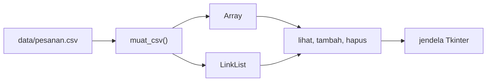
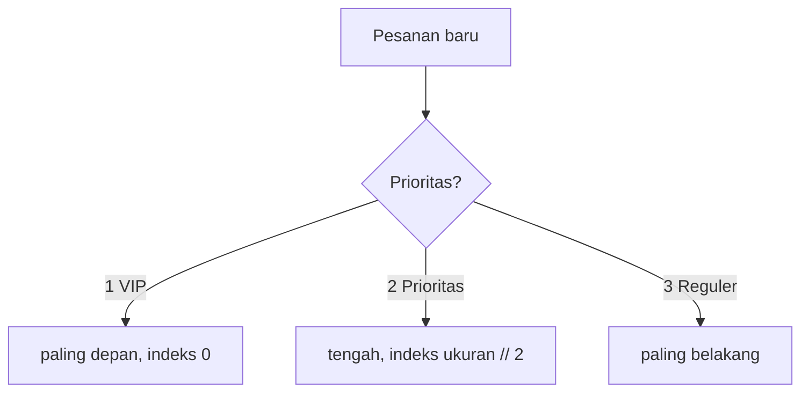

# 2EZ4U Food Delivery
 
Proyek mata kuliah Struktur Data dan Analisa Algoritma (EC234303), Departemen Teknik Komputer.
 
- Nama: **Malikal Fitransyah Alwan**
- NRP: 5024251005
- Dosen: Ir. Arta Kusuma Hernanda, S.T., M.T.
- Bahasa: Python 3.11+ (hanya pustaka bawaan, tidak ada yang perlu di-install)
## 1. Deskripsi proyek
 
2EZ4U adalah engine backend layanan antar makanan versi mini, mirip GoFood atau GrabFood, lengkap dengan satu jendela Tkinter untuk memperagakannya. Datanya 200.000 pesanan yang dibaca dari `data/pesanan.csv`.
 
Semua struktur data dan algoritmanya dibuat manual tanpa fungsi instan Python seperti `dict`, `set`, `sorted`, `.sort()`, `heapq`, `bisect`, `collections`, literal `{}`, dan comprehension dict/set. List Python hanya saya pakai sebagai petak memori berukuran tetap (`[None] * kapasitas`), sesuai aturan tugas.
 
Proyek ini terdiri dari tiga lapisan:
 
1. **Data** (`data/`): `pesanan.csv` dan `peta.csv`.
2. **Backend** (`backend/`): satu berkas untuk tiap milestone.
3. **Frontend** (`frontend/ui.py`, dijalankan lewat `app.py`): jendela yang memanggil backend, lalu menampilkan hasil, jumlah perbandingan, dan waktu tiap perintah.
### Status
 
| Milestone | Isi | Berkas | Status |
|---|---|---|---|
| M1 | Array vs Linked List: lihat, tambah, hapus pesanan | `m1_pesanan.py` | Selesai |
| M2 | Queue dan stack (untuk undo) | `m2_antrean.py` | Selesai |
| M3 | Berbagai jenis sort, ditambah linear dan binary search | `m3_laporan.py` | Selesai |
| M4 | Berbagai jenis search | `m4_pencarian.py` | Belum |
| M5 | Menu per rentang harga, dispatch prioritas | `m5_katalog.py` | Belum |
| M6 | Peta dan navigasi rute | `m6_peta.py` | Belum |
 
## 2. Struktur folder
 
```
2ez4u_5024251005/
├── README.md
├── app.py                 # python app.py
├── data/
│   ├── pesanan.csv
│   └── peta.csv
├── backend/
│   ├── m1_pesanan.py      # Array dan LinkList
│   ├── m2_antrean.py      # Tumpukan, kasir, antrean naif dan melingkar, undo/redo
│   └── m3_laporan.py      # insertion sort, merge sort, linear dan binary search
├── frontend/
│   └── ui.py              # jendela Tkinter
```
 
## 3. Cara menjalankan
 
Pastikan Python 3.11 atau lebih baru sudah terpasang. Tkinter sudah ikut bersama Python di Windows.
 
```
git clone <URL-REPO-GITHUB>
cd 2ez4u_5024251005
python app.py
```
 
Setelah jendela terbuka, klik **Load** di panel kiri. Data dibaca dari `data/pesanan.csv`, dan setelah itu semua menu bisa dipakai. Kalau mau memakai file lain, ketik lokasinya di kotak "Lokasi file CSV" pada menu Load (kolomnya harus sama).
 
Menu di panel kiri:
 
- **DATA**: Load.
- **M1 - DATA PESANAN**: lihat, tambah REGULER, tambah PRIORITAS, tambah VIP, dan hapus, masing-masing untuk Array dan Linked List.
- **M2 - STACK DAN QUEUE**: Postfix (mesin kasir), Undo, Redo, Enqueue, Dequeue naif, Dequeue circular.
- **M3 - SORT DAN SEARCH**: Insertion sort, Merge sort, Linear search, Binary search.
Panel **COMMAND** di bawah mencatat tiap perintah beserta waktunya. Kotak kuning di paling bawah berisi penjelasan singkat tiap menu.
 
## 4. Data
 
`data/pesanan.csv` punya 9 kolom: `oid`, `pelanggan`, `resto`, `menu`, `harga`, `prioritas`, `t_masuk_detik`, `t_selesai_detik`, dan `status`.
 
- `oid` berformat `O-000001` sampai `O-200000`.
- `prioritas`: 1 untuk VIP, 2 untuk prioritas, 3 untuk reguler.
- `t_selesai_detik` kosong untuk pesanan yang belum selesai, saya simpan sebagai `None`.
- `status`: `DONE` (163.993), `CANCEL` (16.157), `ANTRE` (19.850).
## 5. M1: Array vs Linked List
 
Data yang sama saya simpan di dua struktur sekaligus supaya kecepatannya bisa dibandingkan langsung.
 

 
Posisi penyisipan bergantung pada jenis pesanan:
 

 
**Array.** Array saya adalah petak `[None] * kapasitas`. Kalau penuh, saya buat petak baru dua kali lebih besar, salin semua isinya, lalu petak lama dibuang. Penyalinan itu memang O(n), tapi hanya terjadi sesekali, jadi rata-rata menambah di belakang tetap O(1) (amortized). Pada 200.000 pesanan, kapasitas akhirnya 262.144.
 
**Linked List.** Tiap pesanan dibungkus satu simpul (`Node`) yang menyimpan nilainya dan penunjuk ke simpul berikutnya. Saya menyimpan penunjuk `tail` juga, supaya menambah di belakang tidak perlu menelusuri dari depan.
 
| Operasi | Array | Linked List |
|---|---|---|
| Lihat pesanan ke-i | O(1) | O(n) |
| Tambah REGULER | O(1) amortized | O(1) |
| Tambah PRIORITAS | O(n), menggeser | O(n), menelusuri |
| Tambah VIP | O(n), menggeser semua | O(1) |
| Hapus pesanan ke-i | O(n), menggeser | O(n), menelusuri |
 
Contohnya di aplikasi: tambah VIP di Array menggeser 200.000 elemen ke kanan, sedangkan di Linked List cuma mengubah `head`. Sebaliknya, melihat pesanan di indeks 100000 hampir seketika di Array, tapi di Linked List harus melangkah 100.000 kali dari `head`. Waktunya bisa dilihat langsung di panel COMMAND, dan angkanya berbeda di tiap komputer.
 
Satu catatan: kalau VIP ditambah berturut-turut, yang terbaru berada paling depan karena selalu masuk di indeks 0, jadi urutan antar-VIP terbalik. Itu konsekuensi aturan "VIP masuk di urutan pertama".
 
## 6. M2: Queue, Stack, dan Undo/Redo
 
### Kasir (stack)
 
Tumpukan saya bangun di atas Array dari M1. Struk ditulis dalam bentuk infix, lalu dihitung dua tahap dengan tumpukan. Tahap pertama mengubah infix menjadi postfix. Tahap kedua menghitung postfix tersebut.
 
```
( 3 * 12000 ) + ( 2 * 8500 ) - 5000
postfix : 3 12000 * 2 8500 * + 5000 -
TOTAL   : Rp 48.000
```
 
Pada tahap pertama, operator ditahan di tumpukan sampai gilirannya tiba, dan tanda kurung hanya dipakai untuk mengatur tumpukan. Pada tahap kedua, tiap operator mengambil dua nilai teratas, dan **operand kanan keluar lebih dulu** (penting untuk `-` dan `/`, kalau terbalik hasil `10 - 3` jadi salah). Angka berdigit banyak seperti `12000` dibaca sebagai satu token. Menu Postfix menampilkan tabel langkah: baris `1.x` untuk konversi dan `2.x` untuk perhitungan.
 
### Antrean naif vs melingkar
 
Isi kedua antrean sama: 19.850 pesanan berstatus ANTRE. Bedanya hanya pada `dequeue`.
 
```
naif       : ambil indeks 0, lalu geser SEMUA sisanya ke kiri     -> O(n)
melingkar  : ambil data[front], lalu front = (front + 1) % K      -> O(1)
```
 
| Hasil di aplikasi | Naif | Melingkar |
|---|---:|---:|
| 1 dequeue pada ±19.850 pesanan | sekitar 19.850 elemen digeser | 0 |
| 100 dequeue berturut-turut | 1.979.950 elemen digeser | 0 |
 
Enqueue sama-sama murah di keduanya karena hanya menempel di belakang. Semua selisihnya ada di dequeue.
 
Keputusan desain antrean melingkar:
 
- Saya pakai `count` untuk membedakan antrean kosong dan penuh. Pada antrean melingkar, dua kondisi itu sama-sama membuat `front == rear`, jadi tanpa `count` keduanya tidak bisa dibedakan.
- Kalau penuh, kapasitasnya tumbuh dua kali lipat (tidak menolak). Isi disalin berurutan mulai dari `front`, lalu `front` kembali ke 0.
- `dequeue` pada antrean kosong mengembalikan `None`, bukan error.
### Undo dan Redo
 
Setiap aksi dicatat ke tumpukan undo:
 
| Aksi | Undo | Redo |
|---|---|---|
| ENQUEUE | keluarkan dari belakang kedua antrean | masukkan lagi |
| DEQUEUE xN | kembalikan N pesanan ke depan antrean itu, urutan aslinya terjaga | keluarkan lagi |
| ORDER (tambah pesanan di M1) | cabut dari struktur pada indeks tadi | sisipkan lagi di indeks yang sama |
| HAPUS (hapus pesanan di M1) | sisipkan lagi di indeks tadi | cabut lagi |
 
Aksi baru apa pun mengosongkan tumpukan redo, karena riwayatnya sudah bercabang. Saya juga mencatat aksi tambah dan hapus dari M1, supaya urutan undo selalu runtut dan indeksnya tidak meleset.
 
## 7. M3: Sort dan Search
 
| Fungsi | Sifat |
|---|---|
| `insertion_sort` | di tempat, stabil, O(n²), menolak data lebih dari 20.000 baris |
| `merge_sort` | stabil, O(n log n), sanggup mengurutkan 200.000 baris |
| `linear_search` | data boleh acak, O(n) |
| `binary_search` | data harus terurut menurut oid, O(log n) |
 
Kunci pengurutan bisa `oid`, `harga`, atau `selesai`. Pesanan yang belum selesai ditaruh paling akhir kalau kuncinya `selesai`. Setiap algoritma menghitung jumlah perbandingan dan pemindahan. Angka ini sama di komputer mana pun, tidak seperti waktu.
 
### Jumlah perbandingan vs n (kunci harga)
 
| n | Insertion sort | Merge sort |
|---:|---:|---:|
| 500 | 55.847 | 3.829 |
| 1.000 | 233.802 | 8.650 |
| 2.000 | 962.430 | 19.240 |
| 4.000 | 3.831.520 | 42.355 |
| 8.000 | 15.058.881 | 92.616 |
| 16.000 | 60.049.240 | 200.936 |
| 200.000 | ditolak (batas 20.000) | 3.226.139 |
 
Kalau n dilipatduakan, perbandingan insertion sort naik sekitar 4 kali (962.430 menjadi 3.831.520), sedangkan merge sort hanya sekitar 2 kali (19.240 menjadi 42.355). Itu perbedaan antara O(n²) dan O(n log n).
 
### Linear vs binary search
 
Mencari `O-137442` di antara 200.000 pesanan: linear search membutuhkan 137.442 perbandingan (ketemu di indeks 137.441), sedangkan binary search hanya 17.
 
Binary search ada ongkosnya: daftar terurut oid harus dibangun dulu dengan merge sort (sekitar 1 sampai 2 detik untuk 200.000 baris). Daftar itu dibangun sekali saja, dan dibangun ulang otomatis kalau isi data berubah. Ongkos pembangunan ini dicatat di panel COMMAND.
 
### Kenapa saya pilih algoritma ini
 
- **Merge sort untuk data besar.** Jumlah langkahnya tidak bergantung pada bentuk data, ia stabil, dan sanggup mengurutkan seluruh 200.000 baris. Pada n = 16.000 saja insertion sort sudah butuh sekitar 300 kali lebih banyak perbandingan.
- **Insertion sort hanya untuk data kecil.** Sederhana dan bekerja di tempat, tapi kuadratik pada data acak. Karena itu menunya menolak data di atas 20.000 baris dengan pesan, supaya program tidak membeku.
- **Linear search cukup kalau mencari sekali dua kali**, karena tidak perlu mengurutkan dulu dan datanya boleh acak.
- **Binary search hanya untung kalau dipakai berulang** pada data terurut. Satu pencarian murah, tapi membangun daftar terurutnya mahal.
Soal stabil: dua pesanan dengan kunci sama tidak bertukar urutan. Insertion sort stabil karena syarat geser memakai `>` (bukan `>=`), dan merge sort stabil karena saat menggabungkan, elemen dari bagian kiri didahulukan (`<=`). Buktinya di data ini: `O-000002` dan `O-000009` sama-sama berharga 11.000, dan setelah diurutkan menurut harga keduanya tetap berurutan seperti semula.